# 元件库（本地单机版）

给自己用的元件台账：**拍照 / 粘清单 → 自动整理入库**；谁拿走了什么，**手动记一笔**；录错了还能**撤回**。
只在你自己的电脑上跑，不用登录、不用联外网，数据就是一个 `.db` 文件。

- 不联网、不装数据库、不用 pip 装任何东西
- 图片识别用的是 Windows 自带的中文 OCR，离线、免费
- 一个人录入，没有账号、没有权限、没有管理口令

## 预览

| 库存 | 图片识别入库 |
| --- | --- |
| 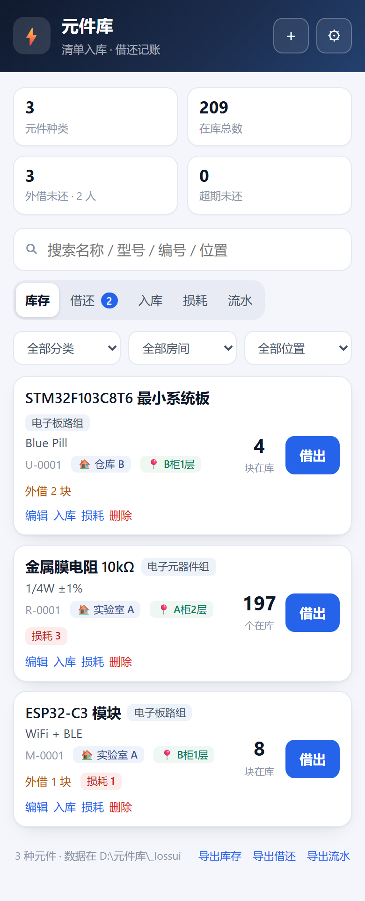 | 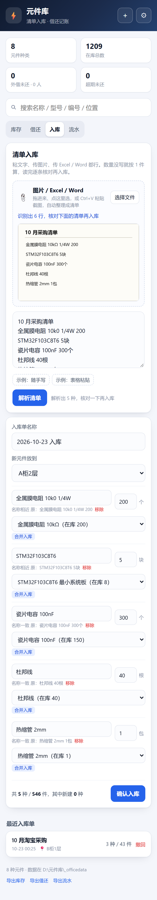 |

| Excel 导入 | 入库单（可整单撤回） |
| --- | --- |
| 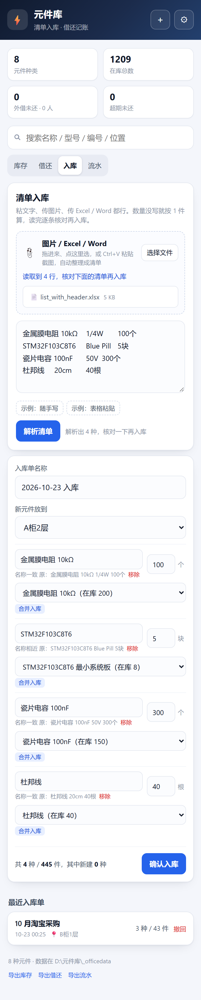 | 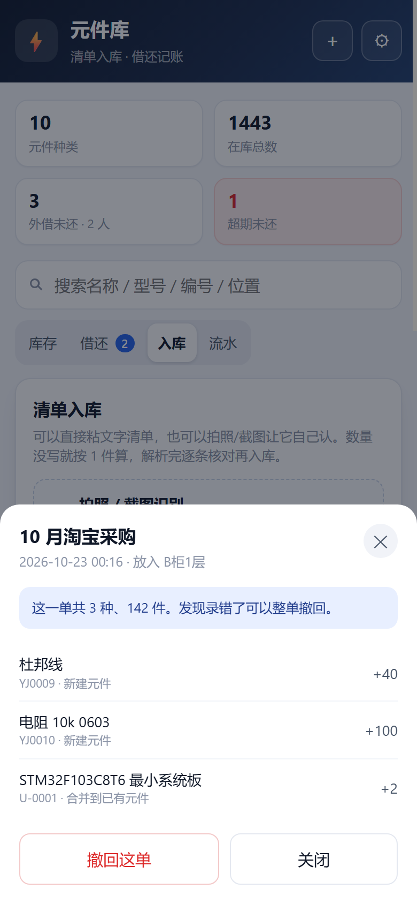 |

| 流水（撤回留痕） | 借还 |
| --- | --- |
| 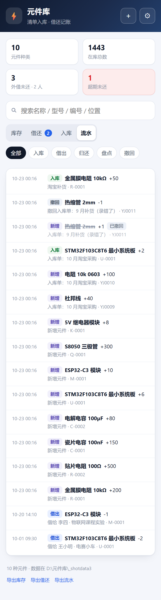 | 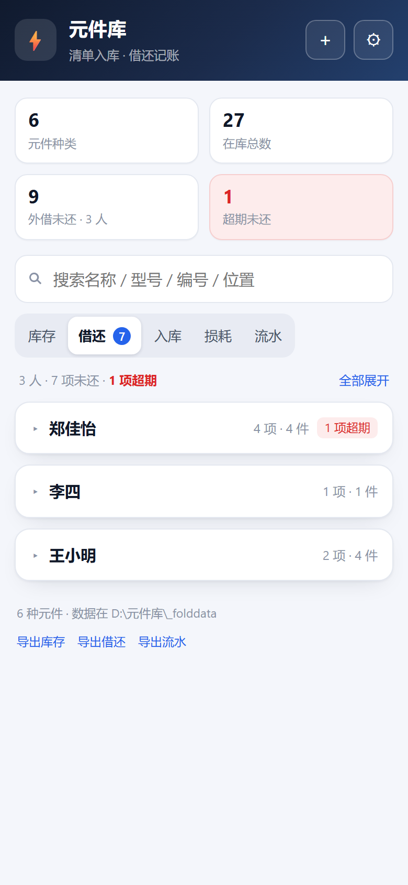 |

| 借出（可永久借出） | 归还（入库 / 记损耗） |
| --- | --- |
| 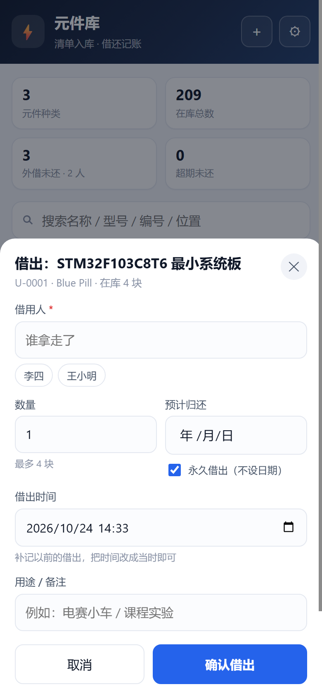 | 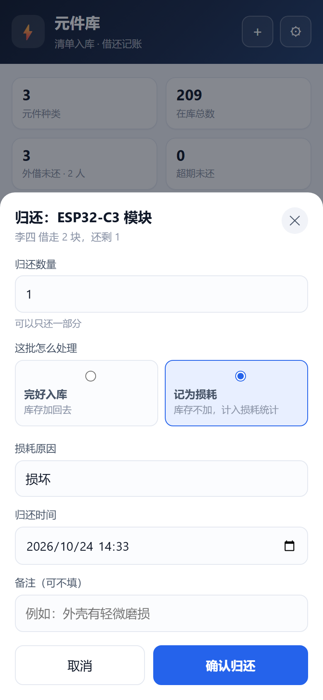 |

| 损耗统计 | 设置 |
| --- | --- |
| 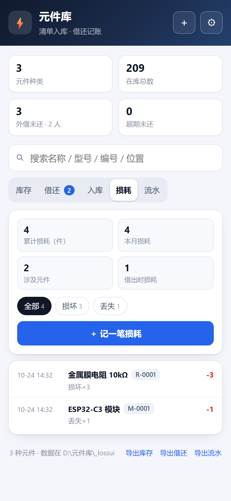 | 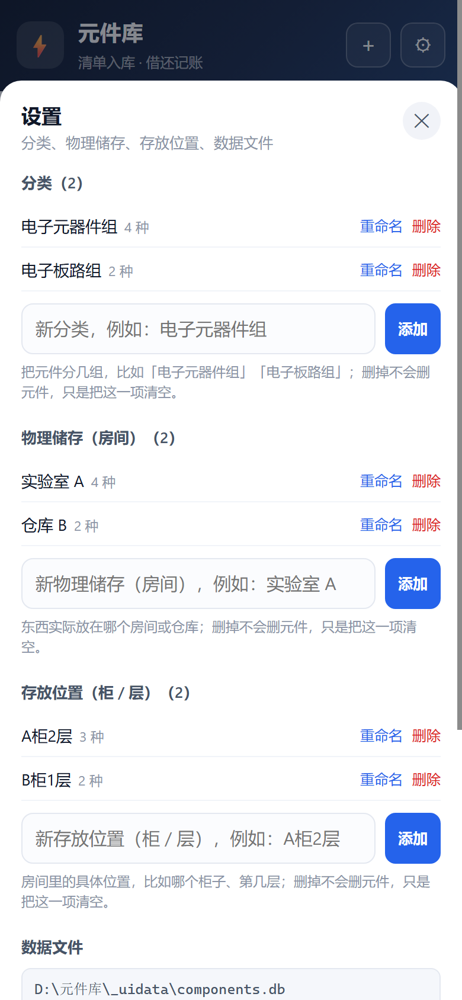 |

桌面端：


---

## 一、启动

1. 双击 **`启动元件库.bat`**
2. 浏览器自动打开 `http://127.0.0.1:8787`
3. 黑窗口别关，关了服务就停；数据已经写进文件，不会丢

> 已经开着一个的时候，再双击不会重复启动，只会把浏览器切回那个页面。
> 需要 Python 3.9+。这台机器上是 3.13，3.11 也验证过。

## 二、入库：图片 / Excel / Word / 粘文字

打开 **入库** 页，四种方式随你用，最后都走同一张**可改的确认清单**。

### 1）拍照或截图识别

把发票、采购单、手写清单一拍，或者随手截个图：

- **拖图片**进虚线框
- **点「选择文件」**挑图片
- 或者直接 **Ctrl+V** 粘贴截图

程序会离线识别（1 秒左右），把文字填进下面的清单框，再自动解析成一条条待入库的条目。


识别难免有错（比如 `Ω` 认成 `0`、`金` 认成 `全`），所以**不会直接入库**，而是给你一张可改的清单：

- 名称、数量都能改；多余的点「移除」
- 认出的元件标「合并入库」，下拉框可以改成别的或「新建元件」
- 认不出的标「新建」
- 选好「新元件放到」哪个柜子，点 **确认入库**

> 图片越清晰、越正、字越大，识别越准；歪着拍的照片会在识别前自动摆正。

### 2）传 Excel（.xlsx）

把采购表、库存表直接拖进来，自动读**第一个工作表**：

- 有表头（含「名称」「数量」这类字）就按列名取数，**规格、单位也能一起带进来**
- 没有表头就按列顺序拼成「名称 / 规格 / 数量」
- 空行、合计行、标题行自动跳过
- 老版 `.xls` 请先在 Excel 里另存为 `.xlsx`


### 3）传 Word（.docx）

正文里的**每一段**和**每一张表格**都会读出来：

- 表格按行转成「名称 / 规格 / 数量」
- 段落按一行一件处理，比如「杜邦线 40根」
- 标题、表头、合计这类行会自动跳过

### 4）粘贴文字清单

支持这些写法，一行一件：

```
金属膜电阻 10kΩ 1/4W 200
STM32F103C8T6 5块
瓷片电容 100nF, 300个
杜邦线 40根
ESP32-C3	WiFi+BLE	4
```

- **行尾的数量**当入库数量；没写就按 1 件算，并在行下标出来
- 逗号、制表符分隔的表格行也行（可以直接从 Excel 复制三列：名称/规格/数量）
- `#` 开头的行、表头、`清单`/`合计` 这类标题行、`-----` 分隔线会自动跳过
- 同名条目自动合并

### 5）确认入库

点「确认入库」后生成一张**入库单**，弹窗列出这一单存了什么、进了哪个柜子；之后在“最近入库单”里随时能翻。

## 三、谁拿走了什么 → 手动记

库存页找到元件 → **借出** → 填借用人、数量、**借出时间**（默认现在，可改成当时）、预计归还。

- 借出时间可以补记，比如事后想起来“上周三他拿走的”，把时间改过去就行
- 还回来：**借还** 页按人折叠，点姓名展开明细 → **归还** → 可以只还一部分，归还时间也能补记
- 借还页顶部有「全部展开 / 全部收起」，人多的时候不用一个个点

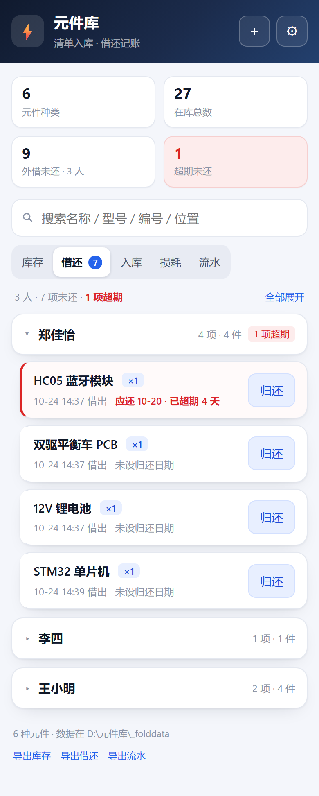
- **预计归还默认不设**：勾着「永久借出」就不算超期；要设日期就取消勾选，默认给一周后
- 超期的整条标红，顶部显示超期笔数

## 四、撤回（录错了怎么办）

两个层级，都留痕，都能追溯。

### 整张入库单撤回

入库单详情里点 **撤回这单**（列表里每条也有「撤回」）：

- 这一单加进去的数量**原样减回库存**
- 如果是这单新建的元件、并且还没被动过，会一并移除
- 撤回后入库单标「已撤回」，流水里原记录打上「已撤回」


### 单个元件撤回

如果只是手动「入库」或「盘点」按错了，库存卡片上会多一个 **撤回**：

- 只撤回这个元件**最近一次**手动入库/盘点
- 弹窗会写清楚：原来 +100，库存 250 → 150，确认了才执行
- 撤不动的情况会直接拒绝（比如撤回后库存会变成负数）

## 五、损耗统计

坏掉、丢掉、烧掉的元件，不用算进借还，直接在「损耗」页记一笔：

- **手动记**：库存卡片上的「损耗」按钮，或损耗页的「＋ 记一笔损耗」，填数量、原因（损坏 / 丢失 / 烧毁 / 过期，也可以自己写）、备注
- **归还时记**：借出去的东西还不回来，在归还弹窗里选「记为损耗」——这笔借出照样结清，但库存不加，直接计入损耗
- 记损耗会**立即扣库存**，并在流水里留一条「损耗」记录

损耗页顶部四个数：累计损耗、本月损耗、涉及元件、借出时损耗；下面按原因筛选，再列出每个元件损耗了多少、最近一次是什么时候。


> 损耗和「入库 -N / 盘点」的区别：损耗有原因、进统计；盘点只是把数量改对。

## 六、清单之外的材料 → 手动加

右上角 **＋** → 名称必填，分类、物理储存、存放位置、型号、数量、安全库存都能选。
库存为 0 时点「入库」也能补：正数是进货，负数是盘亏修正，都会留痕。

## 七、分类、物理储存、存放位置（都自己建）

**⚙ 设置** 里能维护三份名单，每份都可以随时添加、改名、删除：

| 名单 | 用来回答 | 例子 |
| --- | --- | --- |
| **分类** | 这是哪一类东西 | 电子元器件组、电子板路组 |
| **物理储存（房间）** | 在哪个屋 / 仓库 | 实验室 A、仓库 B |
| **存放位置（柜 / 层）** | 房间里的哪个柜子第几层 | A柜2层、B柜1层 |

元件可以同时带这三项：**房间**告诉你“在哪个屋”，**位置**告诉你“哪个柜子哪层”，
库存卡片上分别显示成 `🏠 实验室 A` 和 `📍 A柜2层`，分类则显示成标题旁的彩色标签。

- 新增 / 编辑元件时，三个下拉框最后一项都是 **「＋ 新建…」**，可以当场建，不用先去设置
- 批量入库时也能给整批新元件指定分类、房间、位置
- 库存页顶部三个下拉可以**任意组合筛选**（比如：实验室 A 里、电子元器件组、A柜2层的）
- 改名会同步到所有元件；删掉某一项不会删元件，只是把这一项清空

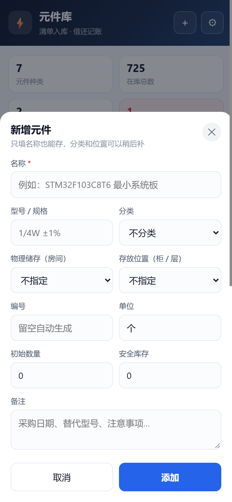

## 八、数据放在哪 / 怎么备份

默认在 `data\components.db`，**整个文件复制走就是备份**。

想换个地方（推荐换个好找的目录，比如 `D:\元件库数据`）：

1. 双击 **`更换数据位置.bat`**，粘贴路径，回车
2. 下次启动就在那里建 `components.db`
3. 如果旧位置已有数据，先把旧的 `components.db` 复制过去

也可以直接改 `config.json`：

```json
{
  "data_dir": "D:\\元件库数据",
  "port": 8787,
  "host": "127.0.0.1"
}
```

- `data_dir` 留空 = 用本文件夹的 `data`
- 每周点一次 **`备份数据.bat`**，会在 `backup\` 生成带时间戳的副本

## 九、导出

页面底部三个链接（设置里也有）：

- 导出库存 CSV
- 导出借还 CSV
- 导出流水 CSV

都带 BOM，Excel 双击直接打开不乱码。

## 十、数据清理

**⚙ 设置 → 数据清理**，面板顶部先给你看现状：多少元件、多少已删除、几张入库单（其中几张已撤回）、多少流水、数据库多大、几份备份。

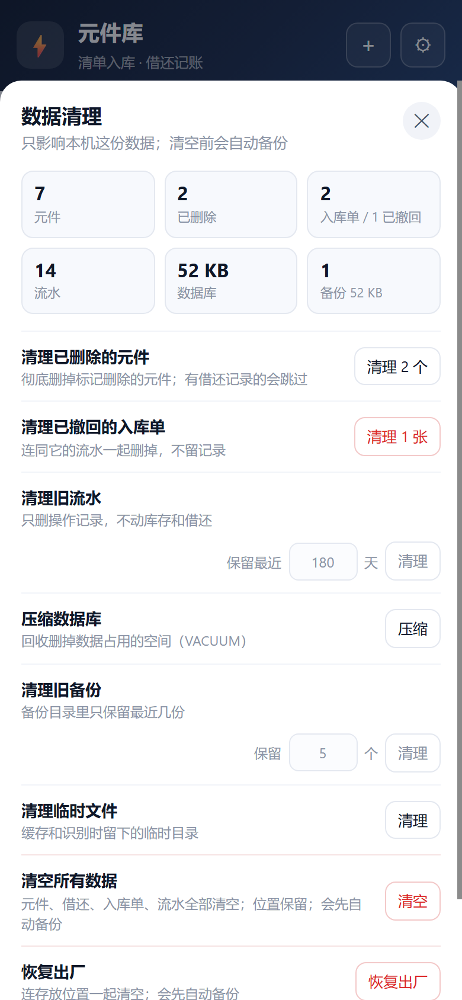

| 操作 | 会做什么 | 安全性 |
| --- | --- | --- |
| 清理已删除的元件 | 把“隐藏”的元件彻底删掉；有借还记录的会跳过 | 删了不可恢复 |
| 清理已撤回的入库单 | 删掉撤回的单子和它的流水 | 删了不可恢复 |
| 清理旧流水 | 只删 N 天前的操作记录，**不动库存和借还** | 不可恢复 |
| 压缩数据库 | VACUUM，回收空间，文件变小 | 安全，随时可做 |
| 清理旧备份 | `backup\` 只留最近 N 份 | 删了不可恢复 |
| 清理临时文件 | 缓存、识别时留下的临时目录 | 安全 |
| 清空所有数据 | 元件、借还、入库单、流水全清空，**位置保留** | 要输入「清空」；**自动先备份** |
| 恢复出厂 | 连位置一起清空 | 要输入「清空」；**自动先备份** |

清空/恢复出厂前会自动在 `backup\` 里留一份 `components_before-reset_*.db`，误点了还能捞回来。

## 十一、常见问题

**图片识别没反应 / 识别不出字？**

- 确认是 Windows 10/11，且装过**中文语言包**（系统自带 OCR 引擎随语言包安装）
- 图片别太小、别太糊；手机拍的正着的照片效果最好
- 只支持 JPG / PNG / WEBP / BMP；iPhone 的 HEIC 请先转成 JPG
- 识别失败不会影响手动粘贴，照样能入库

**Excel / Word 导入没读到东西？**

- 只支持 `.xlsx` / `.docx`；老版 `.xls` / `.doc` 要先“另存为”
- Excel 只读**第一个工作表**，表头要有「名称」「数量」这类字样才按列取数
- Word 只读**正文段落和表格**；图片、文本框里的字读不到
- 合并单元格、公式没算过的空值可能读成空，导入后可以在预览里补齐

**端口 8787 被占用？**
会自动往后找空端口，看窗口打印的实际端口；也可以 `python server.py --port 9000`。

**能不能让手机也打开？**
可以。`python server.py --host 0.0.0.0`，然后手机访问窗口里打印的 `192.168.x.x:8787`（首次会弹防火墙，允许“专用网络”）。默认只监听本机，别人打不开。

**换电脑？**
把整个文件夹拷过去，Python 装好，双击启动即可；数据在 `data\` 或你设置的 `data_dir` 里。

**误删了元件？**
库存里删除是“隐藏”，历史流水仍然保留，但元件不会回到列表，需要重新添加。日常盘亏建议用「入库 -N」而不是删除。

**想开机自动启动？**
把 `启动元件库.bat` 的快捷方式放进 `shell:startup`（Win+R 输入即可打开启动目录）。

## 十二、文件结构

```
元件库/
├─ 启动元件库.bat        ← 双击启动
├─ 更换数据位置.bat      ← 自定义数据存放目录
├─ 备份数据.bat          ← 一键备份
├─ server.py             ← 后端：HTTP 服务 + SQLite（仅标准库）
├─ ocr.ps1               ← 调 Windows 自带 OCR 识别图片（离线）
├─ backup.py             ← 在线备份脚本
├─ set_data_dir.py       ← 写 config.json 的小工具
├─ config.json           ← 数据目录、端口（可手改）
├─ web/                  ← 前端页面
├─ data/components.db    ← 你的数据
├─ backup/               ← 备份快照
├─ screenshots/          ← 界面预览
└─ 使用说明.txt          ← 三步上手
```

## 十三、想继续加

- **二维码贴纸**：每个元件盒贴一张，手机扫码直接打开该元件借出
- **照片**：元件表加一列图片路径
- **超期提醒**：定时把超期清单推到微信/钉钉机器人
- **扫码枪**：USB 扫码枪就是键盘输入，在搜索框扫条码即可定位

说一声就加。
